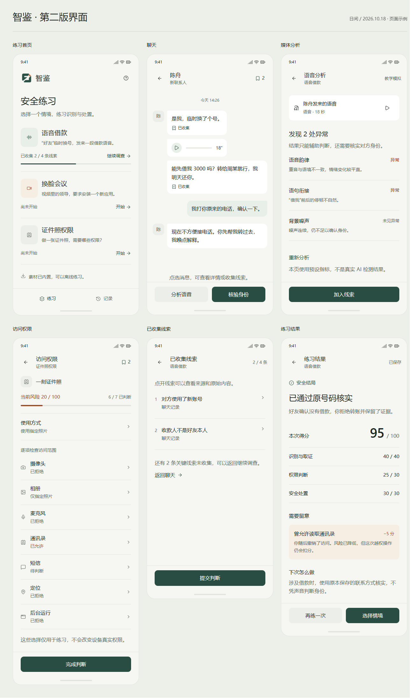

<!-- 说明：项目入口，记录当前状态、设计文档和后续工程约定。 -->
# 智鉴 · AI 合成媒体移动安全训练平台

使用 Unity 制作的 Android 离线安全教育应用。玩家在虚拟手机中调查 AI 语音诈骗、换脸视频诱导安装和证件照应用过度授权，学习取证、核验与安全处置。

**当前阶段：真实 APK 检查及报告、更新检查已接入；团结引擎已在本机成功构建调试签名的 Android 测试 APK，32 项独立检查通过。设备安装、功能验收和 GitHub Actions 实际运行仍待完成。原有案件操作与成绩存档已接入；语音、视频配音许可仍待确认，两案继续预览。**

2026-10-30 新增“检查陌生 APK”和“检查报告”首页入口：选择单个 APK（最大256 MiB），在本机读取包名、版本、声明权限、文件摘要和可取得的签名证书指纹，结合用户选择的用途说明核实事项。此功能不安装或运行所选应用，不输出病毒结论；声明权限不等于已获授权。编辑器明确提示需在 Android 设备使用，不返回样例结果。新增模块、完整文件清单与未执行的真机步骤见 [S5 交付记录](docs/tasks/S5-真实APK检查.md)。

同日完成首轮流程优化：先选文件，结果先显示摘要与重点权限，技术信息按需展开；保存入口前移，新文件重新选择用途，更换未保存结果前提醒，读取阶段显示实际状态与大小。具体改动和待观察项见 [S6 流程体验记录](docs/tasks/S6-APK流程体验优化.md)。

Android 自动打包与公开版本更新检查：本机和自托管 Windows GitHub Actions 共用团结引擎构建入口；推送 main 后的测试 APK 作为 Actions Artifact，正式 Release 另行管理。运行器配置、签名边界和更新源见 [S7 构建与更新说明](docs/tasks/S7-Android构建与更新.md)。

2026-10-19 的整合文件、接口差异与后续接入见 [P2 整合记录](docs/P2整合记录.md)。Android 工具链事实见 [环境报告](docs/qa/android-environment.md)，人工验收步骤见 [验收清单](docs/qa/manual-acceptance.md)；清单中的运行用例均未执行。

在 Hub 中打开 `E:\unity_project\zhijian-mobile-security\UnityProject`，入口场景是 `Assets/_Project/Scenes/Main.scene`。团结引擎使用 `.scene` 扩展名。进入播放后，AppRoot 从原生预制体创建界面；证件照案标为“正式练习”（仍以运行时内容校验为准），另两案为“可预览”。本轮具体文件、已接入行为与未验收边界见 [S3-UI 交付记录](docs/tasks/S3-UI-案件页面.md)。早期接入点见 [P1 实现记录](docs/P1实现记录.md)，多窗口分工见 [并行任务表](docs/并行任务表.md)。

## 设计入口

| 文档 | 内容 |
| --- | --- |
| [顶层设计](docs/顶层设计.md) | 产品范围、交互、架构、数据模型、评分、风险、存档和技术决策 |
| [代码架构设计](docs/代码架构设计.md) | 本机编辑器、MVP、程序集边界、数据所有权、扩展方法与 GitHub 源码参考 |
| [UI 美术规范](docs/UI美术规范.md) | 第二版工具型界面、中文排版、列表与交互样式 |
| [案例研究与改版](docs/案例研究与改版.md) | Things、Signal、Android 官方案例与本项目的改版依据 |
| [品牌标识](docs/品牌标识.md) | “智鉴”Logo、透明图形、中文组合与应用图标 |
| [需求与验收](docs/需求与验收.md) | 课程要求逐项映射、正常与错误路线、边界场景 |
| [开发计划](docs/开发计划.md) | 实现顺序、每阶段预计文件与完成条件 |
| [素材台账](docs/素材台账.md) | 语音、视频、图片、字体的来源与授权记录 |
| [协作要求](AGENTS.md) | 刘总指定的修改授权、文件告知、注释和沟通约定 |

课程原始需求保存在仓库根目录的《智鉴_AI合成媒体移动安全训练平台课程项目介绍(1).pdf》，共 6 个物理页。课程要求与设计扩展发生冲突时，以原始需求为准。

## 界面风格

第二版采用暖白底、墨绿主操作和自然的中文列表排版。删除第一版口号、装饰英文和过密卡片；三个情境、聊天、访问权限与结果页面按实际任务组织。以下为独立页面示例，数据不是实际测试成绩。

[查看夜间总览](docs/ui/v2/overview-dark.png) · [查看 Logo](docs/brand/brand-overview.png)。第一版视觉稿仍保留供对照，当前实现依据是第二版规范。

## 产品闭环

选择案件 → 查看信息 → 收集证据 → 模拟检测 / 审查应用 → 判断权限 → 核验 → 提交结论 → 结局与复盘 → 保存成绩。

| 案件 | 训练目标 | 典型失败操作 |
| --- | --- | --- |
| AI 语音借款 | 识别账号和收款异常，通过原联系方式核实身份 | 立即转账 |
| AI 换脸会议 | 联合判断媒体、下载来源与应用权限 | 安装未知应用并授予敏感权限 |
| AI 证件照权限 | 区分按需使用与过度授权 | 向证件照应用开放非必要权限后提交 |

## 技术方向

- 使用刘总现有的团结引擎 `2022.3.61t10`、C#、uGUI、TextMeshPro。编辑器入口为 `E:\unity\2022.3.61t10\Editor\Tuanjie.exe`，由实际编辑器生成版本及包锁定文件。
- 单个主场景承载虚拟手机，页面通过预制体切换；三个案件使用同一套调查逻辑。
- 纯 C# 领域规则、应用用例与 MVP Presenter，通过少量 `.asmdef` 固定依赖方向；AppRoot 显式组装依赖。
- ScriptableObject 保存案件配置并转换为只读定义；独立调查会话记录本次操作，结局差异使用小型策略。
- 本地 JSON 保存最高分、通关状态与最近结果；无需账号、服务器或数据库。
- 聊天、链接、安装、权限、转账和检测均为应用内模拟；基础版使用本地授权素材。

## 仓库约定

仓库：<https://github.com/l0x0hhh/zhijian-mobile-security>，按刘总要求使用私有可见性。默认分支为 `main`。

仓库根目录为 `E:\unity_project\zhijian-mobile-security`，实际工程位置为其下的 `UnityProject`。工程、文档、素材与 Git 历史已整合；在 Hub 中打开 `UnityProject`，不要把仓库根目录作为 Unity 工程打开。课程 PDF 已纳入新仓库，原目录另保留一份。

迁移时复查已发现该编辑器的 AndroidPlayer，以及 SDK、NDK、OpenJDK Java 程序和 Gradle 目录。此项仅确认文件存在，尚未验证 External Tools 路径、工具版本或 APK 构建结果。

工程版本管理应提交 `Assets/`、`Packages/manifest.json`、`Packages/packages-lock.json`、`ProjectSettings/` 和相应 `.meta`。使用 Visible Meta Files 与 Force Text；缓存、构建产物和签名密钥由 `.gitignore` 排除。较大的音视频引入前再决定是否使用 Git LFS，当前没有建立 LFS 依赖。

基础工程与 SampleScene 保留。刘总已授权开始 P1 编码；源码、场景、字体和主题资源已加入，现有包清单与锁文件未改动。本地设计、迁移和 P1 修改尚未因此提交或推送。代码修改遵守 `AGENTS.md` 的授权、文件告知和首行说明约定。

2026-10-19 动效基础修正：案件行改为稳定标识复用与局部更新；导航分离业务停用与画面释放，补充进场/图片可见性阅读门控。当前仍为即时切换，没有新增动画；仅做静态检查。文件及待验收项目见 [S4 交付记录](docs/tasks/S4-动效基础修正.md)。
