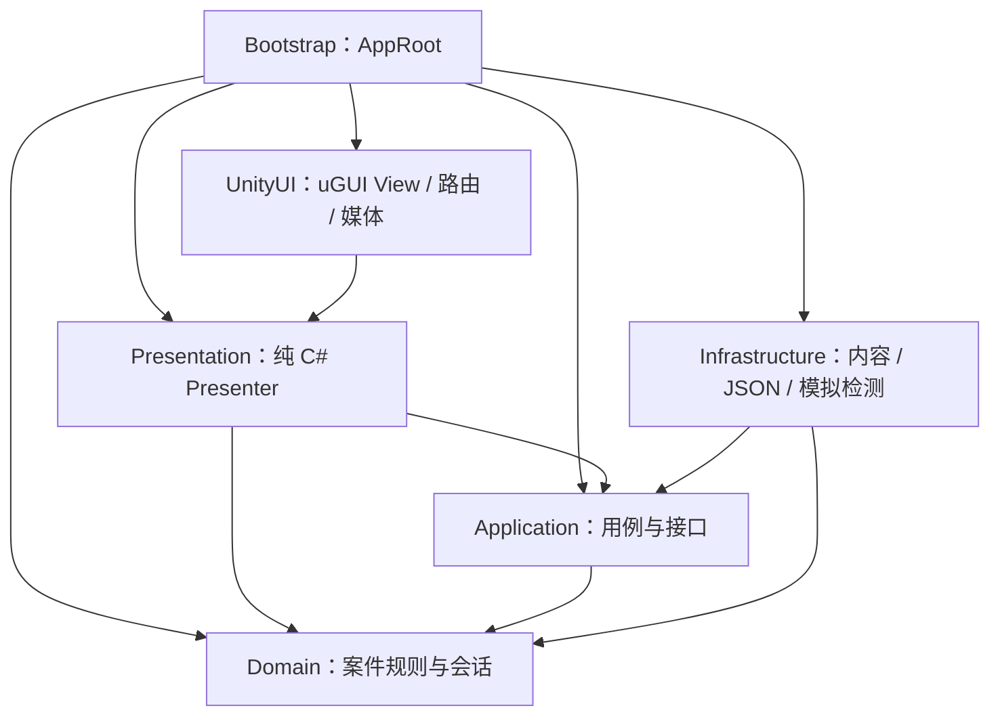

<!-- 说明：记录团结引擎代码边界与扩展方式；P1 基础代码已落盘，完整业务分阶段接入。 -->
# 智鉴代码架构设计

版本：1.3；日期：2026-10-19；状态：P1 预览、领域规则和 P2 首批内容/应用服务已落盘；调查操作页、媒体与存档仍待接入，未编译或生成 APK。

本设计细化 [顶层设计](顶层设计.md)，采用 **纯 C# 业务核心 + MVP 界面 + 配置驱动案件 + 显式依赖组装**。目标是让增加案件、修改教学规则、调整界面与更换存储各有明确落点。课程业务规则仍见顶层设计，视觉实现依据 [UI 美术规范](UI美术规范.md)。

## 1. 开发环境与工程位置

| 项目 | 决定 / 已核实事实 |
| --- | --- |
| 编辑器 | `E:\unity\2022.3.61t10\Editor\Tuanjie.exe`；文件产品版本 `2022.3.61t10_3c39e943eae5`，产品名 Tuanjie |
| 版本策略 | 使用刘总现有团结引擎；替代早期 Unity 6.3 LTS 建议。由编辑器实际创建工程并生成版本文件，包版本以生成后的兼容结果与锁文件为准 |
| 工程路径 | `E:\unity_project\zhijian-mobile-security\UnityProject`；已由刘总创建，与 Git 仓库、文档和素材整合到全英文路径 |
| 渲染与 UI | 普通 2D / Built-in 方案、uGUI、TextMeshPro；手机界面不依赖额外渲染管线 |
| Android 环境 | 迁移时复查已发现 AndroidPlayer、SDK、NDK、OpenJDK Java 程序和 Gradle 目录；尚未检查工具版本或实际构建 |
| APK 前置 | 核对 External Tools 的配套路径与工具版本；在真实验收设备明确后锁定 API 与架构选项，再执行实际打包 |
| 本次整合 | 迁移原仓库与文档，复制课程 PDF 并在原地留一份；保留已创建的工程，未修改业务代码、启动编辑器或编译 |

源码放在同一个英文路径仓库，一起追踪脚本、场景、`.meta`、配置、授权素材及文档。工程路径统一使用 `E:\unity_project\zhijian-mobile-security\UnityProject`，不维护两套智鉴源码，不建立目录联接或双向同步。原目录保留课程 PDF 副本，不作为开发仓库。

Unity 2022.3 文档作为同代 API 参考；团结引擎的模块安装和具体兼容性以本机版本为准。Android 构建依赖说明见 [Unity 官方文档](https://docs.unity3d.com/2022.3/Documentation/Manual/android-sdksetup.html)。

## 2. 设计模式如何服务本项目

| 采用的模式 | 本项目中的落点 | 解决的问题 |
| --- | --- | --- |
| 分层与依赖倒置 | Domain、Application、外部适配器 | 业务规则不依赖 Unity 场景或文件系统 |
| MVP | `ChatView → ChatPresenter → InvestigationService` | 按钮和排版变化不会改变评分；Presenter 可用简单假 View 检查行为 |
| 配置驱动 | `CaseAsset → CaseDefinition` | 三个案件共用页面与调查流程，内容差异由数据表达 |
| 小型状态机 | 调查生命周期、扫描子状态 | 明确终局、取消、重复点击的合法行为 |
| 策略 | 三种 `ICaseOutcomePolicy` | 不把语音转账、安装授权、照片权限结局塞入每个按钮 |
| Repository / Adapter | 案件读取、成绩存储、教学检测 | 存储格式或内容来源变化时，只替换对应实现 |
| 组合入口 | `AppRoot` 显式构造并连接依赖 | 依赖关系可以顺着代码追踪，资源释放有所有者 |

首版用构造函数注入依赖，由 `AppRoot` 手动组装。接口只放在需要隔离引擎、持久化、替换实现或进行独立检查的边界，不给每个数据类和规则类机械增加接口。共享规则可以是普通纯函数类；不建通用工作流语言、反射命令总线、全局服务定位器或多层抽象基类。

这仍是一个进程内的离线应用。领域层只包含案件、会话、权限、证据和结果等真实概念，不增加微服务或在线账号模块。

## 3. 模块与依赖约束

箭头表示代码引用方向；接口的实现位于箭头外侧。Bootstrap 是唯一允许同时认识具体 UI、业务用例和外部实现的组装入口。



| 运行时程序集 | 允许引用的本项目程序集 | 职责 |
| --- | --- | --- |
| `Zhijian.Domain` | 无 | 定义、会话、证据、权限、评分、结局策略、冻结结果 |
| `Zhijian.Application` | Domain | 调查用例、异步任务协调、进度保存、仓储与检测接口 |
| `Zhijian.Presentation` | Application、Domain | Presenter、View 接口、页面显示数据、导航和播放接口 |
| `Zhijian.UnityUI` | Presentation | MonoBehaviour View、页面工厂、路由栈、公共组件、主题、安全区、音视频播放适配器 |
| `Zhijian.Infrastructure` | Application、Domain | ScriptableObject 内容转换、资源索引、模拟检测、文件存档与迁移 |
| `Zhijian.Bootstrap` | 上述五个 | 场景引用、实例创建、依赖连接、应用生命周期与释放 |

前三个程序集开启 `No Engine References`，业务数据不能包含 `GameObject`、`Sprite`、`AudioClip`、`MonoBehaviour` 或 Unity 序列化特性。UnityUI 的 View 接口参数使用 Presentation 自己的显示数据与交互意图；不为了省一次转换，把 Domain 类型泄漏给 View。

从工程首阶段建立这些少量 `.asmdef`，每个模块一个，不按每个页面分程序集。统一命名空间 `Zhijian.<模块>`；项目脚本不散落到默认 `Assembly-CSharp`。依赖通过显式引用建立，禁止环形引用；Domain、Application 和 Presentation 的引擎隔离由程序集约束。Unity 对这些选项的说明见 [Assembly definitions](https://docs.unity3d.com/2022.3/Documentation/Manual/ScriptCompilationAssemblyDefinitionFiles.html) 与 [No Engine References](https://docs.unity3d.com/2022.3/Documentation/Manual/class-AssemblyDefinitionImporter.html)。

`Zhijian.Editor` 单独设为仅 Editor，承载配置检查和项目工具；运行时程序集不得引用它。未来规则测试也有独立 Editor 测试程序集，按验证目标引用所需模块，不进入 APK。尚未创建这些文件，也未进行编译检查。

## 4. 数据所有权与关键契约

| 对象 / 接口 | 所属层 | 责任与约束 |
| --- | --- | --- |
| `CaseAsset`、`CaseCatalogAsset` | Infrastructure | Inspector 可编辑的内容资产；只存定义，不存玩家进度 |
| `CaseDefinition` | Domain | 深度转换后的只读定义；集合对外不可写，引用使用稳定 ID |
| `InvestigationSession` | Domain | 一次调查唯一的可变业务实体；内部状态私有，通过业务方法改变 |
| `InvestigationService` | Application | 当前会话的独占所有者；检查请求上下文、调用领域方法、处理扫描、发布快照 |
| `SessionSnapshot` | Application | 对外只读的状态副本；含 sessionId、revision、可执行动作和调查进度 |
| `CaseResult` | Domain | 一次终局唯一的冻结结果；包括依据、评分明细、内容版本与评分规则版本 |
| `ICaseRepository` | Application | 列出有效案件与读取定义；提供结构化配置错误 |
| `IDetectionService` | Application | 按媒体 ID 返回预设教学分析；可取消，结果不带 Unity 对象 |
| `IProgressRepository` | Application | 读取、提交和迁移版本化学习记录；返回明确成功、失败或不兼容状态 |
| `ProgressService` | Application | 应用级成绩聚合、结果去重与串行保存；页面不直接读写文件 |
| `IChatView` 等 | Presentation | 展示页面数据，发出用户意图；不暴露 uGUI 组件 |
| `IPageNavigator`、`IMediaPlayer` | Presentation | 导航与媒体显示能力；具体实现由 UnityUI 提供 |

只读集合必须包住独立副本或真正不可变数据。只给可变 List 换一个接口类型不能保护配置。SO 转换只复制小规模文字、规则与标识；音视频二进制仍由 Unity 资源引用管理，不复制一份媒体到会话中。

`mediaId` 在纯 C# 定义里是字符串标识。Infrastructure 的资源索引持有实际 Clip / Texture 引用；Bootstrap 将其解析能力接到 UnityUI 的播放适配器，不让 UnityUI 反向依赖 Infrastructure。View 使用自己的 `MediaRequest`，Presenter 负责转换 ID 与文字稿。

代码中的接口、ID 和目录先保持明确，不引入序列化任意类型、动态程序集加载或运行时解析脚本。新增业务不靠配置中的类名、方法名或反射调用。

## 5. 一次操作的完整链路

以“允许通讯录”作为例子：

1. `PermissionView` 发出权限 ID 和选择范围，Presenter 组装当前 sessionId 与命令标识。
2. `InvestigationService` 检查会话仍有效、未终局、权限属于本案、范围合法。
3. `InvestigationSession` 完成一次同步领域事务：更新选择、记录首次越权、重算当前风险、判断即时结局。
4. 同一事务中若命中失败，先冻结唯一 `CaseResult`，再对外提供快照；不得先发布一个还能继续操作的中间状态。
5. Application 发布最新快照，Presenter 将其转换为界面数据。若产生结果，交给应用级 `ProgressService` 保存。
6. View 显示风险或结果；保存状态可以稍后更新，不改写业务结局。

所有领域写入在 Unity 主线程上的同一用例入口串行发生，一次领域事务不包含 `await`、文件 IO 或媒体等待。异步完成必须回到同一调度上下文，重新检查 sessionId、requestId 和生命周期后才能提交结果；基础版不使用 `Task.Run` 操纵会话或 Unity 对象。

API 返回结构化结果，例如 Accepted、AlreadyApplied、StaleSession、InvalidAction、SessionClosed、MissingRequirements。错误提示由 Presenter 映射为中文；配置错误和存档失败保留开发诊断信息。通知事件只负责刷新，不负责“再加分”或“再判结局”。订阅者不能在刷新回调中重入修改会话，后续用户动作进入下一次分发。

`revision` 用于拒绝旧快照覆盖新 UI；涉及“按现有证据提交”的确认时，还用于核对用户确认的就是当前调查状态。重复按钮点击不能产生第二份结果或第二次奖励。

## 6. 生命周期、页面与异步任务

业务调查使用三个核心状态：`Investigating`、`Resolved`、`Aborted`。内容加载属于 Application 的启动状态，提交校验是一个操作而非持久阶段。完成调查标记与页面位置相互独立，允许自由往返。

| 当前状态 | 行为 | 结果 |
| --- | --- | --- |
| Investigating | 阅读、取证、权限、用途、核验 | 规则允许时更新状态 |
| Investigating | 普通提交但缺必做项 | 返回缺项，继续调查 |
| Investigating | 普通提交且条件齐备 | 按安全策略生成并冻结结果 |
| Investigating | 即时危险动作 | 直接 Resolved，不受普通提交门槛限制 |
| Investigating | 确认退出调查 | Aborted，取消任务，释放页面与媒体 |
| Resolved / Aborted | 旧业务命令或扫描回调 | 拒绝修改 |
| Resolved | 重试保存 | 使用同一份 resultId 和冻结结果 |
| 任意结束状态 | 重开案件 | 创建新的 sessionId，不复用旧可变状态 |

保存状态单独使用 Pending、Saving、Saved、Failed；保存失败不会把已失败的案件变回可操作状态，也不会把安全结果改成失败。结果页面在保存期间可显示，离开页面不销毁应用级待保存记录。

扫描使用 Idle / Running / Completed / Failed 子状态，同一媒体最多一个有效请求。请求保存 sessionId、mediaId、requestId；取消、离开检测页或重新分析时使旧 requestId 失效。没有既有结果时，取消从 Running 回到 Idle；重新分析被取消时恢复此前的 Completed 结果。取消不会清空已完成检测标记或已收集证据。返回页面从会话快照恢复已完成结果，不能依赖旧 View 留在内存里。已完成的扫描重开不重复给证据分，线索仍走统一收集入口。

播放完成只由成功的媒体回调确认，播放失败、取消或超时不能标记“已播放”。会话和播放请求标识也用于过滤旧媒体回调。切页和应用进入后台时停止或暂停媒体，回前台不自动播放；销毁时释放 RenderTexture 和事件订阅。

PageRouter 仅维护页面栈及独立弹层栈：返回键优先关闭弹层，再回上一页；离开尚未结束的案件需要提示本次进度不保存。切关或结算时清理旧案件页面栈，禁止返回到已经终局的可操作页面。Presenter 的 Bind / Unbind 和 View 生命周期一一配对，多次进出不能增加重复监听。

## 7. 配置与策略的分界

常见内容进入配置：消息、人物、文字稿、媒体 ID、证据映射、权限权重、用途与允许范围、核验选项、处置选项、必做步骤、复盘文案。稳定 ID 独立于展示顺序与标题；显示文本修改不改变存档定位。

| 行为 | 实现方式 | 原因 |
| --- | --- | --- |
| 线索收集与去重 | 共用 `EvidenceRules` | 检查线索属于本案且来源已查看 / 检测结果已产生，再去重计分；四条关键线索共 40 分 |
| 权限范围、用途与风险 | 共用 `PermissionRules` + 数据表 | 同样的三态、范围与按用途重算机制 |
| 评分明细 | 共用 `ScoringRules` | 40 / 30 / 30 结构固定，权限权重按配置 |
| 普通提交门槛 | 共用 `SubmissionValidator` + requiredSteps | 核对是否操作过，不强迫答案正确 |
| 立即转账 | `VoiceLoanOutcomePolicy` | 任意调查阶段可立即失败 |
| 安装与短信 / 通讯录授权组合 | `FaceMeetingOutcomePolicy` | 两种顺序都要命中；终局前允许移除补救 |
| 非必要授权的最终检查 | `PhotoPermissionOutcomePolicy` | 最终提交时判定，和用途、访问范围相关 |

策略接口统一检查即时结局和最终结局，接收只读业务上下文，输出结局、原因 ID 和关联项目；策略不修改状态、不保存文件、不切页面。`OutcomeResolver` 统一执行优先级：即时危险规则先于普通提交规则，最终安全要求与错误类别明确配置/实现，不根据总分或风险条颜色猜测。

策略用稳定 `policyId` 在 Bootstrap 中显式注册。新增相同规则案件只加配置；只有出现新机制才新增一个策略实现及注册。首版只服务三个实际案件，避免为“未来也许”做可视化规则编辑器或节点图。

必须保留的边界：

- 权限区分 Unreviewed、Denied、Allowed(scope)；没操作不视为拒绝。
- 案件三才有拍摄 / 指定照片 / 放弃功能三种意图；其他案件用各自固定或配置上下文。
- 撤销权限降低当前风险，不能擦除首次越权扣分；改变用途也重新检查现有授权与首次越权记录。
- 案件二安装状态或敏感授权改变后都检查组合风险；未终局可移除，终局后不能回滚。
- 案件三不要求聊天与检测；补充线索可以收集，但不得冲破 40 分上限。
- 证据不足四条允许用户确认后提交；确认只提示数量和待调查来源，不提前暴露未发现证据答案。
- 错误核验/分类仍可提交，失败不清空做对分项；总分高也可能失败。

## 8. 评分与内容校验

评分使用“当前状态 + 一次性历史事实”重新计算，不在按钮回调中维护累加总分。

- 证据：按已收集的关键 evidenceId 求和；重复收集无效。
- 权限：最终选择的正确权重合计减去每项首次越权 5 分，最低 0；撤销不会生成抵消历史的奖励。
- 安全处置：可靠核验、正确分类、正确处置各 10 分，分别计算；未完成与答错用不同原因展示。
- `ScoreEntry` 是本次评分的解释明细。历史错误账本仅保存去重事实，不能再与已含扣分的最终分数相加一次。
- 终局用同一套函数冻结分数与解释，界面、记录页和复盘读取同一份结果。

配置转换后执行 `CaseDefinitionValidator`；Editor 工具复用纯数据检查并补充 Unity 资源检查。至少覆盖：ID 唯一、引用存在、四条关键证据、40 / 30 / 30 权重、权限范围合法、必做步骤适用、策略已注册、安全和失败结果齐全、所有必需线索有可达入口、媒体类型与文字稿/字幕及素材记录齐备。

静态检查不能证明所有剧情路线可通关。实施后要用各案明确的安全和失败操作序列验证可达性；配置失败先让对应案件不可选，并显示问题，避免在玩家提交时才发现遗漏。

## 9. 存档、版本与迭代兼容

基础版只保存已结束调查的学习记录，进行中会话不自动恢复。存档路径由 Bootstrap 传入 `Application.persistentDataPath`，文件操作只在 Infrastructure 中发生。

首版 JSON 使用简单 DTO 与明确字段，运行时字典转换成条目列表，避免依赖 Unity JSON 序列化不支持的结构；DTO 不直接复用领域对象或 SO。读取前后都有结构、版本和数值校验。序列化约束参考 [Unity 2022.3 serialization](https://docs.unity3d.com/2022.3/Documentation/Manual/script-Serialization.html)。

三个版本各有用途：

| 字段 | 变化时机 | 处理 |
| --- | --- | --- |
| schemaVersion | 存档结构改变 | 显式 vN→vN+1 迁移链；失败保留原文件 |
| contentVersion | 文案、素材、案件内容更新 | 每次结果保留当时的版本与复盘文字，不用新配置重新解释旧成绩 |
| scoringRuleVersion | 分值或正确答案标准改变 | 最高分、通关标记按 caseId + 评分规则版本统计；旧规则记录单独标明 |

应用级 `ProgressService` 单写合并结果，按 resultId 去重并串行保存。各页面/会话不能各自加载旧存档后整份覆盖，以免后完成的旧写入抹掉新成绩。`lastResult` 按结果产生时分配的应用内顺序确定，而不是重试完成时间；重启后从已保存序号继续，系统时钟变化只影响显示时间。保存失败保留待保存结果，后续写入包含它；重试不创建新 resultId。结果保存成功前始终显示未保存状态，基础版不声称进程被强杀后还能找回未落盘结果。

主档写入同目录临时文件，校验完成后按目标平台支持的方式替换，并保留上一份有效备份。主档损坏才尝试有效备份；未知较新 schemaVersion 进入只读兼容提示，不能退回旧备份后覆盖新格式。两个文件均损坏时，先保留原文件并让用户选择新建。未知案件的历史条目保留，不因当前目录暂时不含该案件而删除。

每个当前评分规则下记录最高总分、最高安全分、安全通关标记、最近结果；历史最多保留 10 条，但不能因此丢掉最高分聚合。安全通关标记只由 Safe 置真，失败不得清除。正式迭代修改评分标准时同时更新规则版本、迁移说明与验收案例。

## 10. 计划目录与首批文件

以下为完整目标结构；P1 仅已实现目录、界面与组装部分，实际文件以 [P1 实现记录](P1实现记录.md) 为准。`Scripts/` 每个一级目录放一个对应 `.asmdef`；类名在实现时可适当合并，所有权与引用方向不得含混。

```text
UnityProject/
  Assets/_Project/
    Scenes/Main.scene
    Scripts/
      Domain/
        Cases/          CaseDefinition, EvidenceDefinition, PermissionDefinition
        Sessions/       InvestigationSession, SessionState, SessionAction
        Rules/          EvidenceRules, PermissionRules, ScoringRules, SubmissionValidator
        Outcomes/       ICaseOutcomePolicy, OutcomeResolver, 三个案件策略
        Results/        CaseResult, ScoreEntry
      Application/
        Investigation/  InvestigationService, SessionSnapshot, CommandResult
        Progress/       ProgressService, ProgressSnapshot
        Ports/          ICaseRepository, IProgressRepository, IDetectionService
      Presentation/
        Chat/           ChatPresenter, IChatView, ChatViewData
        Investigation/  Evidence / Detection / Permission / Verification Presenter
        Results/        Conclusion / Result / Records Presenter
        Navigation/     IPageNavigator, PageId
        Media/          IMediaPlayer, MediaRequest
      UnityUI/
        Views/          各页面 View、消息行与权限行
        Navigation/     PageRouter, PageFactory
        Media/          UnityMediaPlayer
        Theme/          ThemeAsset, ThemeApplier
        Layout/         SafeAreaAdapter
      Infrastructure/
        Content/        CaseAsset, CaseCatalogAsset, CaseAssetMapper, CaseRepository
        Detection/      SimulatedDetectionService
        Persistence/    JsonProgressRepository, SaveDataDto, SaveMigrator
      Bootstrap/        AppRoot, AppLifecycleAdapter
    Editor/Content/     CaseValidationMenu
    Tests/EditMode/     关键规则与边界测试（实施阶段建立）
    Data/Cases/         VoiceLoan, FaceMeeting, PhotoPermission, CaseCatalog
    Data/UI/            Theme.asset
    Prefabs/            PhoneShell、Pages、Messages、UI
    Art/                Logo、图标、授权中文字体
    Media/              授权音频、视频、字幕
  Packages/             manifest.json、packages-lock.json
  ProjectSettings/      编辑器生成的项目与平台设置
```

首批实现只覆盖骨架和选关：项目配置、六个运行时程序集、`AppRoot`、最小案件目录与读取接口、选关 Presenter / View、`PageRouter`、`PhoneShell`、主题与安全区。后续按“领域规则 → 语音借款完整闭环 → 复用另外两案 → 交付”增加文件；不提前制造上述所有空类。每阶段的预计文件详见 [开发计划](开发计划.md)。

脚本首行添加简短中文职责注释；Unity 自动生成文件、JSON 和 `.asmdef` 不插入破坏格式的注释。资源及 `.meta` 成对提交，Editor 工具与运行时代码分离。

## 11. 常见迭代会改到哪里

| 迭代 | 预计影响 | 应保持稳定的部分 |
| --- | --- | --- |
| 新增同类型诈骗案件 | CaseAsset、媒体、素材台账、CaseCatalog | 共用页面、调查用例、评分结构 |
| 新增一种结局机制 | 新策略、Bootstrap 注册、配置与对应边界用例 | 聊天和权限 View |
| 更换主题、调整聊天排版 | Theme、Prefab、UnityUI View | Domain、Application |
| 增加第八类模拟权限 | 权限定义、展示标签、规则数据、配置检查 | 共用权限决策和去重机制 |
| 增加新的权限范围机制 | PermissionRules、对应配置与显示数据 | 证据与成绩存储流程 |
| 更换存档格式 | Repository / DTO / Migrator、组装入口 | 案件策略与 UI 排版 |
| 后续另行引入真实检测 | 新检测适配器、必要的等待/错误状态与产品说明 | 证据、权限、评分核心；教学结果与真实结果须可区分 |

扩展点以实际新需求为准。即使有接口，联网、账号或真实检测也需要额外产品设计，不把未来功能视为已实现。

## 12. 验证与交付顺序

本轮仅检查设计与文件一致性，不启动 Unity 编译。实施阶段遵守刘总“不需要编译验证是否可以运行”的要求；需要产出 APK 时，Android 打包属于交付本身，届时执行并如实记录结果。

未来值得保留的规则回归场景：重复证据、权限未判断、首次越权去重、用途改变、安装/授权顺序互换、终局拒绝后续动作、错误答案可提交、高分失败、少证据确认、扫描旧回调、存档写入交错与备份恢复。检查应围绕输入与预期结果，不只确认内部方法被调用。

完成核心语音案件后再复用其余案件，用真实制作过程检查架构是否有效：新增内容若需要复制整套 Presenter 或修改多个无关页面，就先修正职责边界。最后单独验收字体、长文本、媒体、返回键、安全区和真机 APK；设计文档通过不能替代运行结果。

## 13. 参考与取舍

调研日期：2026-10-18。以下是架构研究来源，不是已安装依赖；未复制第三方项目代码或素材到仓库。

- [Unity 官方 QuizU：MVP](https://discussions.unity.com/t/quizu-the-model-view-presenter-pattern-post-4/311043)：借鉴 Model、View、Presenter 的职责划分和多页面组织。官方文章当前样例已更新到 Unity 6.1 / UI Toolkit，因此只借鉴模式，不直接移植到本机团结引擎。
- [Unity 官方设计模式示例 HealthPresenter](https://github.com/Unity-Technologies/game-programming-patterns-demo/blob/edbd64fd5635e567d99cf0cfd4f2f7f37ef9dc97/Assets/UnityTechnologies/_DesignPatterns/7_MVP/Scripts/Pattern/HealthPresenter.cs) 与 [Health](https://github.com/Unity-Technologies/game-programming-patterns-demo/blob/edbd64fd5635e567d99cf0cfd4f2f7f37ef9dc97/Assets/UnityTechnologies/_DesignPatterns/7_MVP/Scripts/Pattern/Health.cs)：已查阅具体源码中的职责与事件订阅。两者均继承 MonoBehaviour，Presenter 直接持有控件；本项目的纯 C# 分离是进一步的设计选择。[该提交工程版本](https://github.com/Unity-Technologies/game-programming-patterns-demo/blob/edbd64fd5635e567d99cf0cfd4f2f7f37ef9dc97/ProjectSettings/ProjectVersion.txt) 为 6000.0.9f1，不当作团结引擎的可直接导入模板。
- [Unity 官方 open-project-1：事件通道源码](https://github.com/UnityTechnologies/open-project-1/blob/608eac98df29cd97821a6115cd52dfb9027345b1/UOP1_Project/Assets/Scripts/Events/ScriptableObjects/VoidEventChannelSO.cs) 与 [监听器源码](https://github.com/UnityTechnologies/open-project-1/blob/608eac98df29cd97821a6115cd52dfb9027345b1/UOP1_Project/Assets/Scripts/Events/VoidEventListener.cs)：借鉴解耦与 OnEnable / OnDisable 对称订阅、退订。[项目 README](https://github.com/UnityTechnologies/open-project-1/blob/608eac98df29cd97821a6115cd52dfb9027345b1/README.md) 说明 2021 年 12 月停止开发，使用 Unity 2020.3，仅作为历史参考。智鉴的评分与终局同步直接调用，实例内事件仅通知刷新。
- [VContainer 组合根与 Presenter 示例](https://github.com/hadashiA/VContainer/blob/fb24d752968c5cabe0cfb4fcf8861c74772c5b14/website/docs/getting-started/hello-world.mdx)、[LifetimeScope 源码](https://github.com/hadashiA/VContainer/blob/fb24d752968c5cabe0cfb4fcf8861c74772c5b14/VContainer/Assets/VContainer/Runtime/Unity/LifetimeScope.cs) 与 [生命周期约束](https://github.com/hadashiA/VContainer/blob/fb24d752968c5cabe0cfb4fcf8861c74772c5b14/website/docs/scoping/lifetime-overview.mdx)：借鉴构造注入和应用 / 会话 / 页面所有权。首版手工组装，不安装容器；其 [package.json](https://github.com/hadashiA/VContainer/blob/fb24d752968c5cabe0cfb4fcf8861c74772c5b14/VContainer/Assets/VContainer/package.json) 声明版本 1.19.0、Unity 2018.4 门槛，不代表已验证团结兼容。作用域销毁也不自动等同于所有已注册 MonoBehaviour 都销毁，资源释放仍须明确归属。
- [Unity 官方 Skills](https://github.com/Unity-Technologies/skills) 和 [uGUI skill](https://github.com/Unity-Technologies/skills/blob/main/skills/ui-ugui/SKILL.md)：后续搭建界面时可参考 Canvas、布局组、TMP、事件系统与有针对性的修改流程。其自动化流程涉及 Unity CLI；尚未验证与本机团结引擎的兼容性，本轮不安装工具，也不把安装 skill 当作架构完成条件。

上述来源提供模式和工作流参考；本项目的分层数量、会话所有权、命令顺序、计分和存档版本策略是根据三案需求作出的设计决策。

## 13. P1 实施记录

入口使用现有团结引擎原生 `Main.scene`，并非早期计划中的 `.unity`。六个 asmdef 已建立，Domain/Application/Presentation 禁止引擎引用；UnityUI 额外引用已有的 UnityEngine.UI 与 Unity.TextMeshPro 包程序集。`NavigationRequest.cs` 合并存放 PageId、导航请求及相关接口，避免为短类型机械拆文件。

AppRoot 从 CaseCatalogAsset 读取三个预览情境，使用 CaseSelectionService、CaseSelectionPresenter、PhonePresenter、InfoPresenter 组装 UI。CaseRowView 动态创建列表行，PageRouter 在离页时解除 Presenter 订阅并销毁 View。PhoneShell 处理公共导航与安全区域；ThemeAsset/ThemeBinding/ThemeApplier 统一配色和动态中文字体。InfoPage 使用原生自动布局容纳长文案。

此轮不实现完整调查会话、危险动作、异步检测、音视频、结果和存档；这些章节仍是后续约束。当前预览返回无需退出调查确认，因为尚无调查状态。日夜选择只在本次运行内保留，记录页为空态，不伪造分数。未编译和运行，资源引用检查不能替代编辑器导入或真机验证。

## 14. 多窗口成果整合

三份交付位于同一个共享仓库，未产生待合并分支。具体文件与真实状态见 [P2 整合记录](P2整合记录.md)。

`IInvestigationCaseRepository` 和 `CaseLoadResult` 承接完整内容；原 ICaseRepository 继续只承接选关摘要。CaseAsset 显式引用 JSON 和媒体资源，CaseAssetMapper 做严格版本/枚举/列表转换，随后复用 CaseDefinitionValidator。Definition、Resource、Release 三类问题分别保存，不能把字符串台账 ID 当成素材已存在或已授权。CaseRepository 仅在全部门槛满足时给出 Available。

InvestigationService 在创建它的线程串行处理命令，以 sessionId 拒绝旧页面操作，媒体仍使用 sessionId/requestId，提交仍核对 revision；只有整个用例结束后才发布只读快照，通知回调重入返回 Busy。有限的会议处置动作由固定 DispositionEffect 枚举表达：None、RemoveSimulatedApp、InstallAndGrantSensitive，不执行任意脚本。结果由 Domain 冻结，ProducedResult 仅标记第一次产生，未来存档必须复用原 resultId。

证据保留 SourceId 作为主来源，同时增加只读 SourceIds 与 RequiredSourceIds；任一取证入口满足后，仍须先满足所有必读前置，最后按同一 evidenceId 去重。用途未选时允许先拒绝访问，允许授权仍须明确用途。JSON 字段到课程文稿 ID 的映射与例外在整合记录中说明。

此轮只在 AppRoot 构造服务，没有将当前预览页改造成调查页；trainingEnabled 仍关闭。实际导入、运行校验器与编辑器菜单均未执行，不能把 API 已组装说成剧情已跑通。
