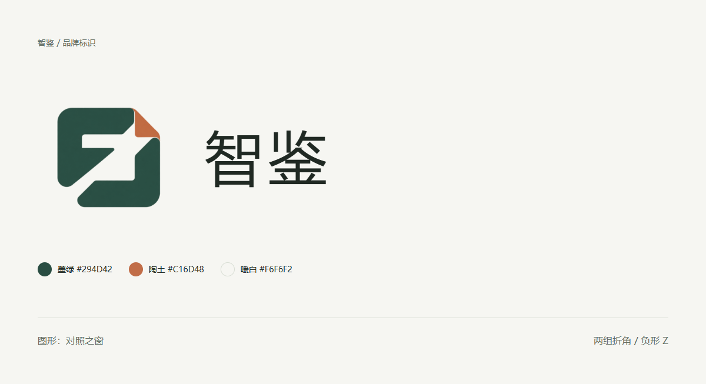

<!-- 说明：记录智鉴 Logo 的设计方向、文件用途与生成过程。 -->
# 智鉴品牌标识

2026-10-18 · 图形名称：对照之窗。

## 1. 图形与名称

两组相向、错位的折角围出一个负形的 Z。折角代表不同来源的材料，中央留白代表对照与辨别；右上小块陶土色作为识别点。图形与“智鉴”的首字母 Z 呼应，没有把指纹、盾牌、眼睛或对勾直接作为品牌标识。

品牌名称只写“智鉴”。应用内顶栏使用中文，不额外堆叠英文全称或宣传语。图形与文字在组合时保持独立，不把名称塞进方形应用图标。

## 2. 交付文件

| 文件 | 格式与尺寸 | 用途 |
| --- | --- | --- |
| [透明图形](brand/zhijian-mark.png) | RGBA PNG，1254 × 1254 | 页面品牌图形、报告与组合排版；保留生成图原有透明留白 |
| [中文横向组合](brand/zhijian-lockup.png) | 透明 PNG，900 × 280 | 封面、启动说明及课程报告；图形与中文名称组合 |
| [方形应用图标](brand/zhijian-app-icon.png) | PNG，512 × 512 | 暖白底图标预览；不是完整的 Android 自适应图标资源包 |
| [品牌总览](brand/brand-overview.png) | PNG，1200 × 653 | 展示图形、名称和色彩组合 |
| [生成记录](brand/generation-prompts.md) | Markdown | 原始提示词、精修提示词、工具与保存方式 |

图形使用内置 imagegen 生成并进行一次保留轮廓的精修；中文名称使用本机中文字体排版，未将字体文件纳入仓库。横向组合、应用图标和总览是对同一图形的排版导出。当前交付是位图，不将 PNG 包装为 SVG 或可编辑矢量源稿。

## 3. 配色与使用

- 主色：墨绿 `#294D42`；点缀：陶土 `#C16D48`；背景：暖白 `#F6F6F2`。这些是品牌目标色，生成位图边缘会包含抗锯齿过渡。
- 顶栏图形区域约 36 至 40 逻辑单位，图形可见轮廓约 26 至 29；“智鉴”字号约 22。
- 以图形可见宽度的 1/4 作为最低留白；不要贴紧屏幕边、按钮或其他品牌。
- 深色界面把同一图形放在固定暖白小底板上，保留辨识度；不直接把深绿色图形放到深色底上。
- 不拉伸、不描外框、不添加发光或立体投影、不把陶土角随案例状态改色。
- 状态颜色与品牌颜色区分：陶土色在 Logo 中是识别点，在界面风险区域需配明确文字，不能让 Logo 本身承担风险状态。

## 4. 当前检查

已确认图形文件有透明通道，并把它用于第二版首页顶栏。横向组合的中文由文字排版生成，避免生成图中文字失真。已检查组合图、方形图标和页面中的缩小效果。

创建正式 Unity 工程时，再按实际启动图与 Android 图标管线导入和切片；本轮未修改工程代码，也未进行编译。
