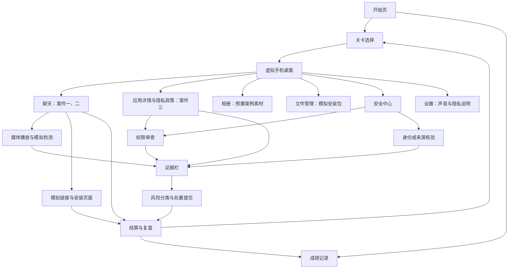
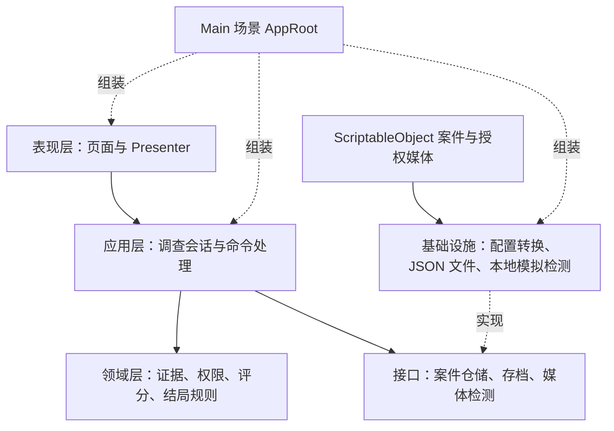
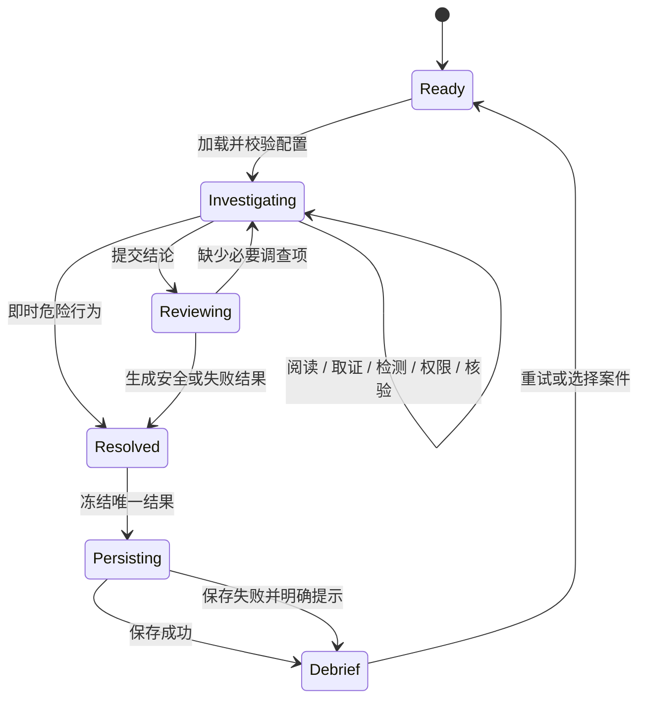

<!-- 说明：依据课程 PDF 制定可实施的产品、架构与核心规则；本文不代表已实现。 -->
# 智鉴顶层设计

版本：0.1；设计日期：2026-10-16；状态：待进入实现。

## 1. 目标与范围

把课程要求落成一款可在 Android 真机演示的离线互动应用：以三个完整案件训练“识别与取证、权限判断、安全处置”，能够说明每一次得失分及其安全含义。

基础版覆盖三个案件、虚拟手机桌面、聊天与本地媒体、模拟检测、权限审查、证据收集、身份或来源核验、双结局、知识复盘、本地成绩与移动适配。三个案件默认可选，便于课堂直接演示。

基础版不训练 AI 模型，不连接真实检测 API，不做真实支付、拨号、安装或系统权限授予，不包含后端、登录、排行榜或广告。聊天外链只进入应用内模拟页面。素材与存档均保留在本地。

角色与核心任务：玩家扮演移动安全分析员，按证据判断，不能只凭“检测器说是假”下结论。检测输出必须标注“教学模拟”，不包装成真实检测能力。

## 2. 体验与页面结构

采用竖屏虚拟手机。页面使用统一标题栏和返回行为；调查页共享证据入口、当前案件标识和风险提示。视觉方向为深色底、青色主操作，风险以文字配合颜色表达，避免只用红绿区分。



| 页面 | 核心内容与反馈 |
| --- | --- |
| 开始与关卡选择 | 标题、开始调查、三个案件卡、最高分和安全通关标识 |
| 手机桌面 | 聊天、相册、安全中心、文件管理、设置五个入口；显示待调查提示 |
| 聊天 | 文字、图片、语音、视频、链接、安装包六种消息；点击或长按可收集线索 |
| 媒体检测 | 本地播放、扫描进度、2 至 4 个预设指标、风险解释与模拟标识 |
| 应用详情 | 开发者、来源、功能、隐私政策；案件三从此处开始 |
| 权限审查 | 七类权限、用途说明、允许 / 拒绝、未判断状态及实时风险值 |
| 核验 | 原联系方式、本人、官方来源与不可靠渠道的选项及反馈 |
| 证据与提交 | 线索列表、关键证据数量、调查完成情况、风险类型和最终处置 |
| 结算与复盘 | 总分、三项能力、结局、错误操作、对应建议、重试和返回 |
| 成绩记录 | 各关最高总分、最高安全通关分、是否安全通关、最近结果 |

界面约束：建议 Canvas 参考尺寸 1080 × 1920，通过 Canvas Scaler 与安全区域布局适配；长聊天与隐私政策允许滚动，底部操作保持可达。中文字体必须覆盖实际用字并记录授权。音视频暂停、切页和退出案件时及时停止播放；视频配置字幕，语音配置文字稿。媒体不可用时提供明确重试提示，不能假装已完成播放。

## 3. 三个案件

以下人物、应用和剧情名称均为设计占位，制作素材时使用虚构身份。

### 案件一：熟悉的声音，陌生的收款人

- 背景：自称好友的人使用新账号发来克隆风格语音，以紧急情况催促借钱。
- 四条关键证据：新账号、收款人与好友不符、语音停顿异常、拒绝通过原号码回拨。
- 模拟检测：语音韵律、停顿衔接、背景噪声三个预设异常指标；只作为辅助证据。
- 核验：通过通讯录中原有联系方式联系本人为可靠方法；追问当前账号、只相信语音或拨打对方新发号码不可靠。通讯录是案例内虚拟联系人。
- 至少四个处置：原联系方式核实并拒绝转账、立即转账、继续向当前账号追问、按对方链接做核验。
- 安全路线：完成调查，可靠核验，识别冒充诈骗，拒绝转账并保存证据。
- 失败路线：“立即转账”在任意调查阶段均立即终止并进入诈骗结局；不因前置步骤未做完而屏蔽该后果。
- 权限环节：增加一个“转账验证助手”模拟诱导页，供安全中心审查其权限。此项是为覆盖通用权限操作的设计扩展，不要求真的安装应用，也不能取代语音借款主线。

### 案件二：会议中的领导，非官方的安装包

- 背景：虚拟领导的视频要求安装所谓会议工具。
- 四条关键证据：音画不同步、面部边缘异常、光照不一致、下载来源非官方。另可加入短信和通讯录越权作为补充证据。
- 模拟检测：固定包含音画同步、面部边缘、光照一致性三项指标。
- 权限：模拟应用至少索取短信和通讯录，安全判断为拒绝；页面可先查看声明，审查不依赖实际安装。
- 核验：通过已知官方渠道或原有联系方式确认会议安排。
- 安全路线：完成调查，拒绝未知安装包，拒绝越权，保存证据并报告风险。
- 失败路线：模拟应用处于已安装状态时，授予短信或通讯录中的任一权限，触发恶意应用结局。安装状态或权限改变后均检查该条件，不能通过改变操作顺序绕过。
- 仅点击下载或仅模拟安装不会自动算作上述失败条件，但须产生风险提示；安全结案前需取消安装或移除模拟应用。

### 案件三：一张证件照，七项权限

- 背景：未知开发者的证件照应用要求广泛授权。
- 四条关键证据：功能与权限不匹配、开发者信息不明、隐私政策过度授权条款、强制后台运行与证件照功能无关。
- 入口为应用详情与隐私政策，不展示无关聊天，不要求媒体检测。
- 七类权限：摄像头、相册、麦克风、通讯录、短信、定位、后台运行。后台运行是教学中的访问能力类别，不宣称对应某个统一的 Android 危险权限。
- 摄像头与指定照片按需允许；默认不要求两者同时授予，可以选择拍摄或指定照片路径。案例内不实际拍照或读取相册。
- 相册采用“仅指定照片 / 全部相册 / 拒绝”的范围区分，不能把全部相册访问等同于指定照片。
- 核验改为检查开发者及分发来源；不是要求玩家给虚构人物回拨。
- 安全路线：按功能选择最小访问范围，拒绝其余访问，识别过度授权并拒绝使用该不可信应用。
- 失败路线：提交时仍允许任一非必要权限或全部相册访问，则进入隐私泄露风险结局。

## 4. 技术决策

| 决策 | 选择与理由 |
| --- | --- |
| 引擎 | 建议 Unity 6.3 LTS；课程规模适合固定 LTS 补丁版。创建工程时写入 ProjectVersion.txt，不手写伪造工程版本 |
| 界面 | uGUI + TextMeshPro，便于预制体搭建手机界面、滚动消息和弹窗；首版不混用 UI Toolkit |
| 场景 | 一个 Main 场景，AppRoot 组合服务，页面预制体切换，避免跨场景状态丢失 |
| 内容 | ScriptableObject 案件资产与媒体引用，三个案件只配置内容和规则差异 |
| 业务 | 独立 C# 数据与规则，不把计分写在按钮回调中；不引入额外依赖注入或事件框架 |
| 媒体 | 本地 AudioSource / VideoPlayer，媒体转为目标设备兼容的格式后再验收；不播放远程 URL |
| 存储 | persistentDataPath 下的版本化 JSON；通过仓储接口隔离文件操作 |
| 网络 | 基础版离线，无后端、云存储和真实检测服务；不用 Supabase |
| 插件 | 优先引擎原生能力；当前不引入第三方付费插件或大型框架 |

技术依据查阅于 2026-10-16：[Unity LTS 支持说明](https://unity.com/releases/unity-6/support)、[ScriptableObject 数据资产](https://docs.unity3d.com/6000.3/Documentation/Manual/class-ScriptableObject.html)、[Android 权限](https://docs.unity3d.com/6000.3/Documentation/Manual/android-permissions-in-unity.html)、[persistentDataPath](https://docs.unity3d.com/6000.3/Documentation/ScriptReference/Application-persistentDataPath.html)。具体 API 和包版本在创建工程后按锁定的编辑器版本确认。

## 5. 分层与模块职责



依赖方向：领域层不引用 UnityEngine 或 UI；应用层编排规则并声明所需接口；基础设施实现接口；AppRoot 在单一入口完成组装。Presenter 只提交用户意图、展示返回状态，不直接修改成绩或存档。

| 模块 | 建议职责 | 不应承担 |
| --- | --- | --- |
| CaseRepository | 读取目录、验证配置、生成独立运行数据 | 修改 ScriptableObject 记录玩家进度 |
| InvestigationSession | 会话生命周期、操作入口、步骤与完成条件 | 文件读写、直接操纵 GameObject |
| EvidenceService | 按 evidenceId 收集、去重、分类关键证据 | 每次点击都加分 |
| PermissionService | 访问范围、决策状态、风险重算、越权事件 | 调用 Android 真权限接口 |
| DetectionService | 预设分析结果与演示延迟 | 声称调用了真实 AI 模型 |
| VerificationService | 判断身份或来源核验是否可靠 | 启动真实电话或浏览器 |
| ScoringService | 三维分数、加扣分原因与操作去重 | 按界面展示次数计分 |
| OutcomeResolver | 即时失败、最终安全与失败规则 | 仅按总分推测是否安全 |
| SaveRepository | 成绩版本、写入、恢复与损坏提示 | 存储真实联系人、人脸或录音 |
| PageRouter / Presenter | 页面、返回栈、媒体释放和状态展示 | 将某一关剧情写死到公共页面 |

不使用跨项目的全局服务定位器。应用内事件只用于视图刷新；关键状态变更由会话直接处理，保证顺序可解释。页面离开时取消订阅；回到旧页面从会话读取快照，不能依赖“页面还活着”。

## 6. 数据模型与配置约束

以下是待实现的数据契约，不是现有类或代码。

| 数据 | 关键字段 | 约束 |
| --- | --- | --- |
| CaseDefinition | id、contentVersion、标题、案例类型、requiredSteps、消息、证据、权限、核验、结局规则 | id 稳定且唯一；配置只读 |
| MessageDefinition | id、消息类型、角色、正文、mediaId、evidenceIds、actionId | 支持六种消息；媒体与动作引用存在 |
| EvidenceDefinition | id、来源、解释、isKey、scoreWeight | 每关恰好四条计分关键证据，每条 10 分；可有非计分补充线索 |
| MediaDefinition | id、类型、资源引用、文字稿 / 字幕、assetLedgerId | 本地资源；来源台账可追溯 |
| DetectionProfile | mediaId、模拟指标列表、结论与局限说明 | 案件一 2 至 4 项；案件二含指定三项；案件三不启用 |
| PermissionDefinition | id、用途、允许范围、是否必要、scoreWeight、riskWeight | 七类访问；权限判断权重每关合计 30 |
| VerificationOption | id、显示文字、reliable、反馈 | 案件一二含原联系方式；案件三为开发者与来源 |
| DispositionOption | id、riskType、处理动作、是否正确、是否立即失败 | 案件一至少四个处置选项 |
| SessionState | sessionId、caseId、阶段、线索集合、权限决策、已读 / 已检测 / 核验状态、模拟安装状态、操作日志 | 与配置隔离；重开案件生成新 sessionId |
| ScoreEntry | ruleId、dimension、delta、reason、relatedItemId | 每个一次性规则在一次会话中最多记一笔 |
| CaseResult | resultId、caseId、contentVersion、三维分数、总分、风险、outcome、错误与建议 | 终局后冻结；成绩和复盘使用同一份结果 |
| SaveData | schemaVersion、案例成绩、最近结果、更新时间 | 只保存必要学习记录，不保存媒体副本和个人资料 |

配置进入调查前应检查：ID 不重复，引用存在，四条关键证据合计 40，权限分合计 30，安全处置合计 30，双结局齐全，必填步骤与案例类型一致，媒体有来源记录。配置错误显示“案例暂不可用”与开发提示，不能让玩家进入无法提交的案件。

## 7. 状态与操作流程

调查步骤允许自由往返，不强制先点完所有聊天再查权限。使用“完成标记集合”表达调查进度，使用小型状态机表达生命周期，避免为每个页面创建一种业务状态。



一次操作按顺序执行：校验会话与合法性 → 修改领域状态 → 记录一次性操作与得失分原因 → 重算当前风险 → 检查即时失败 → 返回新快照。若进入终局则拒绝后续业务操作，只允许展示、重试保存、返回或开启新会话。

媒体扫描属于调查中的子状态。扫描完成回调必须携带 sessionId 与任务标识；切关、重开或退出后旧回调失效。防止重复扫描奖励和连续点击重复结算。

安全提交前检查：背景已查看、四条关键证据已收集、适用媒体已播放并检测、权限已逐项作出判断、可靠核验已完成、风险分类与最终处置已选择。案件三通过 requiredSteps 排除聊天和检测。未满足时列出缺项，不能把省略项算成玩家失分。

危险动作无须等待上述提交门槛，立即进入对应失败结局。错误分类或错误处置在调查完整后提交，也进入失败结局。

## 8. 评分、风险与结局

### 8.1 三项能力，共 100 分

| 能力 | 满分 | 算法 |
| --- | --- | --- |
| 识别与取证 | 40 | 四条关键证据各 10 分，按 evidenceId 首次有效收集计分；补充线索不额外加分 |
| 权限判断 | 30 | 最终决策与预期最小访问范围一致的项目权重之和，减去一次性越权操作扣分，最低 0 分 |
| 安全处置 | 30 | 可靠核验 10 分、风险分类正确 10 分、最终处置正确 10 分；触发失败时该维度为 0 分 |

总分为三个维度之和，范围 0 至 100。权限子项权重按案件配置，总和必须为 30；未判断的项目得 0 分且阻止安全提交。必要权限可以选择拒绝并放弃功能，不把谨慎拒绝判成不安全；允许时必须匹配功能与访问范围。

模拟授予某项非必要访问，首次对该项目记录权限维度扣 5 分；撤销后当前风险下降，历史错误记录与扣分仍保留；同一项目反复开关不能叠加奖励或重复扣分。计分原因包含规则、关联项目与分值。

分数表示能力表现，结局由明确安全规则决定。即使收齐证据后错误授权导致总分较高，结局仍是失败；界面须清晰显示失败原因，不能把“最高分”当作“已安全通关”。

### 8.2 当前隐私风险与案件风险

风险独立于得分，范围 0 至 100。每次访问决策改变后，根据当前允许范围重算，而非累计相加。

案件三建议风险权重：摄像头按需 0、仅指定照片 0、全部相册 20、麦克风 10、通讯录 20、短信 20、定位 15、后台运行 15。相册的“仅指定”与“全部”互斥；所有非必要访问之和最多 100。其余案件在相应权限配置中给出权重，非必要权限权重之和也不超过 100。

界面区分“当前隐私风险”和“案件风险”：前者随撤销而下降，后者展示诈骗、恶意安装等其他风险及已触发的严重事件。当前风险可显示低（0 至 19）、中（20 至 49）、高（50 至 100）；风险为 0 不代表对方身份可信或可以转账。曾经的危险操作仍在复盘中保留。

### 8.3 结果与复盘

结局值：Safe、ScamFailure、MalwareFailure、PrivacyFailure、JudgmentFailure。重试是新的会话，不覆盖之前的正确通关记录。复盘按错误操作逐条给出“做了什么 → 为什么有风险 → 正确做法”，并显示关键证据、三维得分、加扣分明细及模拟检测的局限。

## 9. 存档与异常恢复

基础版只承诺保存已结算成绩，不承诺恢复进行到一半的调查。退出未完成案件时提示“本次调查进度未保存”，再次进入从新会话开始。

每关记录 highestTotalScore、highestSafeScore（未安全通关时为空）、hasSafeClear、lastResult，以及最多 10 条最近结果。hasSafeClear 只可由 Safe 结果置为真；失败不得清空已有安全通关。resultId 去重，重复保存不能重复计入历史。

写入流程：序列化到同目录临时文件 → 完整关闭文件 → 使用平台适用的替换方式更新主存档 → 保留上一份有效备份。读取校验 JSON、schemaVersion、范围和案例 ID；主文件损坏尝试备份，均无效则明确提示并提供新建存档选项，不静默覆盖。未知的新版本存档保留原文件并提示不兼容。

在结果生成后立即保存，不依赖应用退出回调；Android 进程可能直接被终止。保存失败仍可看本次结算，但显示“成绩未保存”，提供重试；重试复用冻结的 CaseResult。文件保存属于内部学习进度，不需要申请共享存储权限。

## 10. 移动安全与素材约束

- 所有权限开关只改变 SessionState，不调用系统权限申请接口。
- 使用预置照片、音频与视频；摄像头、麦克风、通讯录、短信、位置均不实际访问。
- 对敏感来源、真人肖像、声音、字体和第三方素材逐项记录授权；未获授权的素材不能用于交付。
- 不在真实浏览器打开案件链接，不使用真实恶意 APK，不真实发起支付、通话和安装。链接显示虚构域名，安装包仅为元数据与模拟界面。
- 工程建立后检查最终合并的 AndroidManifest，而非只看手写清单；Unity 功能或插件可能自动带入权限。基础版不引入广告、统计或无关网络组件。
- 签名材料与令牌不进入 Git；APK 和工程压缩包按最终交付流程单独提供，仓库只保留可复现的工程与授权资源。

## 11. 未来工程结构

以下目录均为计划，本轮没有创建 Unity 工程。

```text
UnityProject/
  Assets/
    _Project/
      Scenes/Main.unity
      Scripts/
        Bootstrap/          AppRoot、启动与依赖组装
        Domain/             证据、权限、评分、结局与数据契约
        Application/        调查会话、命令、所需仓储接口
        Infrastructure/     JSON 存档、配置仓储、模拟检测
        Presentation/       页面、Presenter、消息与权限组件
      Data/Cases/           三个案件与目录 ScriptableObject
      Prefabs/              手机外壳、页面、消息、弹窗
      Art/                  UI 图片与已授权字体
      Media/                案例音频、视频、字幕
  Packages/                 manifest.json 与 packages-lock.json
  ProjectSettings/          编辑器版本、Android 与序列化设置
```

首版先用命名空间与目录约束分层，不为了目录数量提前增加复杂框架。业务规模扩大后再决定是否使用 asmdef 做编译边界。

## 12. 实施边界与未决项

已决定：三个案件、离线基础版、统一调查流程、模拟权限、三维评分、版本化存档、默认开放关卡、单场景页面切换。

创建工程前需落实：刘总允许开始业务代码实现、已安装的 Unity 编辑器补丁版与 Android 模块、实际验收设备。素材制作前需落实授权来源；截止日期和成员分工尚未提供，开发计划采用阶段完成条件而非编造日历工期。

本轮状态仅为设计完成；所有功能验收均待实施。后续每阶段先告知预计文件，获得适用授权后修改；代码开头补简略注释，不自动编译验证。
